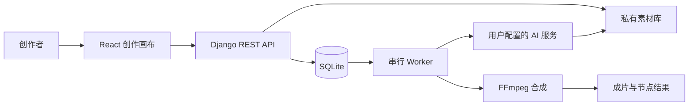

# 镜序 · Storyframe Studio

面向个人创作者的轻量 AI 短剧工作室。通过可视化画布组织剧本、分镜、图片素材、视频生成和配音合成，让创作过程可以保存、追踪和续跑。

本项目采用 AI 辅助开发，关注工作流落地、外部服务联调、任务可靠性与低资源部署。模型由用户自行配置，本项目不包含自研生成模型。

## 功能

- **剧本与分镜**：手动编辑或调用 LLM 生成，支持排序、版本冲突检查、复制与导出。
- **可视化画布**：React Flow 节点编排，连线校验、撤销重做、自动保存，按目标节点及其依赖执行。
- **素材库**：图片和音频上传、去重、配额管理、私有访问及引用保护。
- **AI 服务适配**：用户配置 LLM、图片、TTS 和视频服务；支持通用 JSON 映射、同步/异步提交、查询、取消与下载。
- **参考音色配音**：在配音合成或 AI 配音节点上传参考音频、试听、选择服务并填写文本；音色模仿由所选 TTS 服务提供。
- **视频与音频处理**：图片序列本地成片、字幕渲染、配音合成，以及外部视频生成结果处理。
- **可靠执行**：SQLite 持久队列、单任务串行处理、节点检查点、中间结果复用、幂等和重复提交保护。
- **权限与费用**：API 密钥加密保存，用户数据隔离，短期签名素材链接，按已核价服务保守预留费用。

## 技术架构

| 层 | 技术 |
| --- | --- |
| 前端 | React、TypeScript、Vite、React Flow |
| API | Django、Django REST Framework |
| 数据与存储 | SQLite、本地私有素材目录 |
| 后台执行 | 独立 Worker、单任务持久队列 |
| 媒体处理 | FFmpeg、ASS 中文字幕 |
| 部署 | Docker Compose、Nginx、Linux |



没有 Redis / Celery 依赖。已有部署在约 2 核、1.6GB 内存服务器上运行，适合单机、低并发创作；不将这一配置视为吞吐量或生产 SLA 承诺。

## 开始使用

准备 Python 3.12、Node.js 22+、Docker Compose、FFmpeg 和 Noto CJK 字体。

```sh
python3 -m venv .venv
.venv/bin/pip install -r requirements.lock
.venv/bin/python scripts/init-env.py
cd frontend
npm ci
npm run build
cd ..
```

初始化脚本生成本机 `.env`，请保管生成的管理员凭据和加密密钥。随后按[部署指南](docs/deployment-guide.md)配置主机指标探针、目录权限、域名和 Nginx，再运行 `sh scripts/deploy.sh`。

`studio.example.com` 与 `/opt/storyframe-studio` 均为部署示例，使用前请按自己的环境调整。`PUBLIC_ORIGIN` 须配置为自己的 HTTPS 入口，供应商才能访问经过签名的参考素材。

本地开发步骤见[开发指南](docs/development-guide.md)。

## 验证与能力边界

- 截至 2026-11-07，后端 **91 项**检查通过，前端 **15 项**检查通过，生产构建通过。
- 已完成 10 秒双图参考视频、配音和字幕处理验证；音色参考上传、连线保存和任务快照已完成接口验证。
- 这次成片的图片来自聊天内 ImageGen 后导入素材库。**AutoDL 图片 API 未跑通**，不将该替代方案描述为供应商文生图成功。
- 女声字幕版为已有视频的媒体编辑结果；参考音色功能本次未额外调用付费供应商验证音质。
- 费用预留是保守估计，包含失败或未知请求的预留，不代表供应商实际扣款或账户级硬限额。

`docs/samples/` 内的视频与图像是程序化测试样本，不是实际用户作品。

## 测试

在运行测试前安装上述依赖。以下密钥仅为测试用固定值，不用于部署：

```sh
export SECRET_KEY=synthetic-test-secret
export ENCRYPTION_KEY=MDAwMDAwMDAwMDAwMDAwMDAwMDAwMDAwMDAwMDAwMDA=
cd backend
../.venv/bin/pytest -q
cd ../frontend
npm test
npm run build
```

测试使用隔离数据库与临时素材，AI 供应商调用通过模拟响应验证，不需要填写真实 API 密钥。

## 代码入口

- `backend/core/canvas_flow.py`：画布执行、检查点、费用预留与配音合成。
- `backend/core/video_api.py`：通用 JSON 适配与远程任务管理。
- `backend/core/asset_links.py`：短期签名素材链接。
- `backend/core/storage.py`：素材校验与存储配额。
- `frontend/src/pages/Creator/Canvas/`：画布编辑与参考音频上传。

更多说明：[画布流程](docs/canvas-flow-guide.md) · [视频 API](docs/video-api-guide.md) · [安全设计](docs/security.md) · [API 参考](docs/api-reference.md)。

## 公开仓库内容

仓库仅包含源码、配置模板、说明与合成测试样本。运行数据库、用户素材、真实密钥、服务器访问资料、部署日志和带账号信息的运行截图不在公开内容中。

## License

[MIT](LICENSE)
