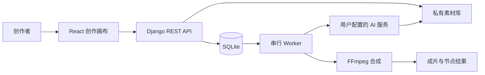

# 镜序 · Storyframe Studio

面向个人创作者的轻量 AI 短剧工作室。通过可视化画布组织剧本、分镜、图片素材、视频生成和配音合成，让创作过程可以保存、追踪和续跑。

本项目采用 AI 辅助开发，关注工作流落地、外部服务联调、任务可靠性与低资源部署。模型由用户自行配置，本项目不包含自研生成模型。

## 功能

- **剧本与分镜**：手动编辑或调用 LLM 生成，支持排序、版本冲突检查、复制与导出。
- **可视化画布**：React Flow 节点编排，连线校验、撤销重做、自动保存，按目标节点及其依赖执行。
- **素材库**：图片和音频上传、去重、配额管理、私有访问及引用保护。
- **AI 服务适配**：用户配置 LLM、图片、TTS 和视频服务；支持通用 JSON 映射、同步/异步提交、查询、取消与下载。
- **参考音色配音**：在配音合成或 AI 配音节点上传参考音频、试听、选择服务并填写文本；音色模仿由所选 TTS 服务提供。
- **视频与音频处理**：本地合成支持最长 60 秒、720p、24 帧/秒和中文字幕。独立视频生成页支持 1–30 秒、横屏、竖屏及方形，最多选 9 张参考图和 3 段参考音频。实际规格由供应商工作流决定。
- **可靠执行**：SQLite 持久队列、单任务串行处理、节点检查点、中间结果复用、幂等和重复提交保护。
- **权限与费用**：API 密钥加密保存，用户数据隔离，短期签名素材链接。生成与重试直接提交，费用以供应商账单为准。

## 当前发布基线

应用版本 `adbb539` 于 2026-11-21 完成部署。

- 设置页加入 AutoDL H3 文生视频、多图多音频和 Happy Pet 图片、视频配置模板。图片适配器支持 Gemini 风格的内嵌 Base64 返回。AI 剧本生成提供 12 种风格，Django 管理后台支持中文标签。
- 生成和重试直接提交。任务详情页在提交期间禁用重试按钮，连接失败后再点同一操作会复用幂等键。有供应商任务 ID 时，可以查询原任务并获取已有结果。另起一次生成可能再次计费。
- 每日备份会先查询活动任务，查询失败或任务未结束时退出。数据库归档和关键配置全部校验后才发布新备份，再保留最近 7 份。[备份与恢复](docs/deployment-guide.md#备份恢复)

## 技术架构

| 层 | 技术 |
| --- | --- |
| 前端 | React、TypeScript、Vite、React Flow |
| API | Django、Django REST Framework |
| 数据与存储 | SQLite、本地私有素材目录 |
| 后台执行 | 独立 Worker、单任务持久队列 |
| 媒体处理 | FFmpeg、ASS 中文字幕 |
| 部署 | Docker Compose、Nginx、Linux |



没有 Redis / Celery 依赖。已有部署在约 2 核、1.6GB 内存服务器上运行，适合单机、低并发创作；不将这一配置视为吞吐量或生产 SLA 承诺。

## 开始使用

准备 Python 3.12、Node.js 22+、Docker Compose、FFmpeg 和 Noto CJK 字体。

```sh
python3 -m venv .venv
.venv/bin/pip install -r requirements.lock
.venv/bin/python scripts/init-env.py
cd frontend
npm ci
npm run build
cd ..
```

初始化脚本生成本机 `.env`，请保管生成的管理员凭据和加密密钥。随后按[部署指南](docs/deployment-guide.md)配置主机指标探针、目录权限、域名和 Nginx，再运行 `sh scripts/deploy.sh`。

`studio.example.com` 与 `/opt/storyframe-studio` 均为部署示例，使用前请按自己的环境调整。`PUBLIC_ORIGIN` 须配置为自己的 HTTPS 入口，供应商才能访问经过签名的参考素材。

公网入口可直接打开平台登录页，不启用额外的浏览器 HTTP Basic 密码验证；业务 API、管理后台和私有素材继续由平台登录与对象权限保护。详见[公网 HTTPS 配置](docs/public-https-guide.md)。

| 我想做什么 | 从哪里开始 |
|---|---|
| 做一条照片、字幕和配音短片 | [使用手册](docs/user-manual.md) · [画布流程](docs/canvas-flow-guide.md) |
| 接入模型并生成短片 | [新手快速上手](docs/quick-start-guide.md) · [视频 API](docs/video-api-guide.md) · [图片 API](docs/image-generation-guide.md) |
| 在本地阅读代码和运行测试 | [开发指南](docs/development-guide.md) · [架构](docs/architecture.md) · [数据库](docs/database-design.md) |
| 部署、恢复或定位问题 | [部署指南](docs/deployment-guide.md) · [公网 HTTPS](docs/public-https-guide.md) · [故障排查](docs/troubleshooting.md) |

## 验证与能力边界

- 2026-11-21 的发布基线 `adbb539` 通过 **107 项后端测试**、**17 项前端测试**，生产构建成功。供应商协议回归使用模拟响应。
- 西乡塘照片版由服务器 Worker 调用 FFmpeg 合成 60 秒视频。动态版实测 IndexTTS2 配音和 H3 分段生成，四段约 15 秒的视频在 Windows 上加字幕、混音并剪成 60 秒，再导回镜序。
- 图片生成模板的实际可用性取决于账号、模型和返回格式。西乡塘动态版复用实景照片，可用上传素材完成视频流程。

仓库的 `docs/samples/` 提供程序生成的测试素材，可用于本地合成。完整回归、两版作品与备份恢复结果见[测试与验收](docs/test-report.md)。

## 测试

在运行测试前安装上述依赖。以下密钥仅为测试用固定值，不用于部署：

```sh
export SECRET_KEY=synthetic-test-secret
export ENCRYPTION_KEY=MDAwMDAwMDAwMDAwMDAwMDAwMDAwMDAwMDAwMDAwMDA=
cd backend
../.venv/bin/pytest -q
cd ../frontend
npm test
npm run build
```

测试使用隔离数据库与临时素材，AI 供应商调用通过模拟响应验证，不需要填写真实 API 密钥。

## 代码入口

- `backend/core/canvas_flow.py`：画布执行、检查点和配音合成。
- `backend/core/video_api.py`：通用 JSON 适配与远程任务管理。
- `backend/core/asset_links.py`：短期签名素材链接。
- `backend/core/storage.py`：素材校验与存储配额。
- `frontend/src/pages/Creator/Canvas/`：画布编辑与参考音频上传。

更多说明：[画布流程](docs/canvas-flow-guide.md) · [视频 API](docs/video-api-guide.md) · [安全设计](docs/security.md) · [API 参考](docs/api-reference.md)。

## 公开仓库内容

仓库包含源码、配置模板、操作指南、历史验收记录与合成测试样本。生产数据库、用户媒体、供应商密钥及管理员凭据由部署者独立保管。公网演示账号用于体验示例内容。

## License

[MIT](LICENSE)
