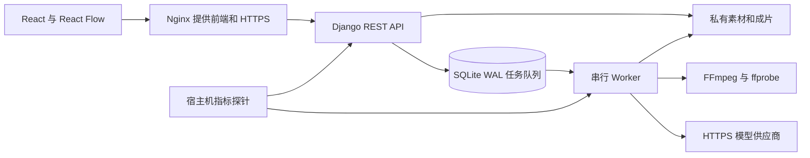

# 架构

适用应用版本 `adbb539`。前端、Web API 和 Worker 组成一条串行制作链。生成和查询由独立进程执行，浏览器通过任务接口看到进度。

## 接口和任务

Web 与 Worker 在两个应用容器里运行，共享 SQLite 数据库和私有媒体目录。宿主机 Nginx 提供编译后的前端，并把请求转发到回环 API。浏览器使用 Session 与 CSRF，业务资源按用户归属读取。[部署与入口](deployment-guide.md)

`POST /api/canvases/{id}/run/` 校验归属和版本，按节点依赖生成输入快照并入队，返回 `202`。同用户、同幂等键返回原任务。Worker 持共享卷文件锁，通过事务认领队列任务，并按 `lease_owner` 有条件地更新状态。供应商请求和编码在数据库事务外执行。[队列实现](../backend/core/queue.py) · [任务模型](database-design.md)

## 媒体和外部服务

- **本地合成**逐分镜读图、读音频、渲染字幕并合成。编码结束后用 ffprobe 校验流和时长，再原子移动成片。[本地合成实现](../backend/core/video.py)
- **外部生成**按快照保存的请求映射调用供应商。异步任务记录原 ID，查询后下载和校验结果。对于带检查点的全流程，节点输出持久化，可按各节点状态继续。[视频适配器](../backend/core/video_api.py) · [全流程执行](../backend/core/canvas_flow.py)
- **供应商参考素材**通过短期签名链接或按映射提供图像内容。用户浏览器走归属校验后的私有素材和成片接口。[安全设计](security.md)

## 画布状态

`schema_version` 描述画布结构，`revision` 用于阻止较旧的编辑覆盖当前版本。文档保存节点、连线、坐标、配置引用与业务引用。任务另存一份执行快照，因此保存、拖动和连线不会启动生成，也不会修改既有任务的输入。[画布指南](canvas-flow-guide.md)
