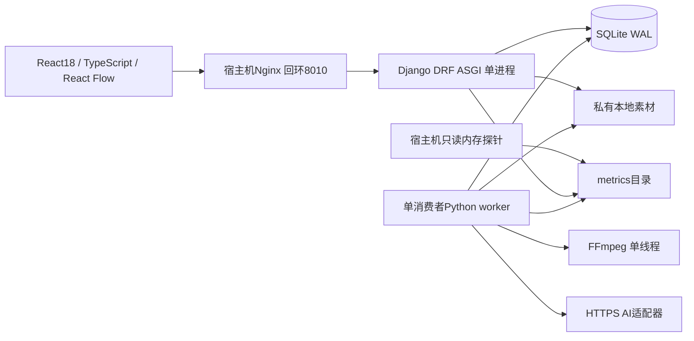

# 架构

仅两个应用容器，无Redis/Celery/PostgreSQL/MinIO常驻服务。前端生产构建后由宿主机Nginx提供静态文件。后台Django Admin复用用户和业务模型。
Session和CSRF同源验证；业务查询强制用户归属，管理员在专门的Admin界面跨用户管理。未鉴权文件请求不能获取私有媒体。
浏览器提交剧本ID或画布ID→后端验证资源、权限和版本→创建不可变快照任务→worker原子认领→逐镜头合成→ffprobe验证→原子移动成片→条件写回成功。前端轮询进度。
SQLite事务仅处理短数据库操作；模型请求和编码均在事务外。worker使用共享卷文件锁确保单实例，并用lease_owner条件更新防止旧执行器覆盖状态。
画布schema_version与revision独立保存。文档仅保存类型、文字、坐标和业务引用；执行时额外建立业务快照。便签、移动或连线不会调用AI。
