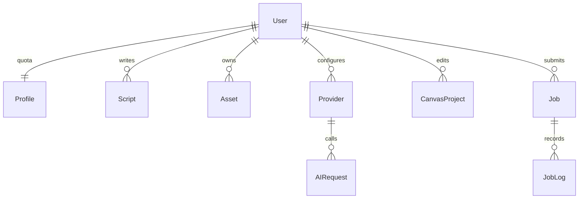

# 数据库与迁移

Profile：存储字节配额、剩余API调用数。Script：标题、梗概、风格、分镜JSON、revision。Asset：随机相对路径、原文件名、类型、哈希、大小、元信息、标签。Provider：服务类型、base URL、model、Fernet密文和脱敏后缀。
CanvasProject：所有者、名称、schema_version、revision、文档JSON、更新时间。JSON含nodes/edges/viewport，服务端验证100节点/200边/512KiB上限及引用权限。
Job：kind/status/stage/progress、不可变snapshot、result、错误类别、幂等键、lease_owner、心跳及各时间、尝试数。JobLog：任务消息和时间。AIRequest：供应商、服务、固定endpoint、submitted/succeeded/failed/unknown、HTTP状态和时间，不保存密钥或请求正文。PromptTemplate由管理员编辑；WorkerHeartbeat用于健康检查。
约束：Asset(user,sha256)唯一；Job(user,idempotency_key)唯一；任务状态有索引。Django外键默认索引。所有用户侧操作必须经归属检查，不把顺序ID当作访问凭证。
SQLite启用WAL、10秒busy timeout、IMMEDIATE事务。迁移仅由一次性步骤执行，0001创建基础模型，0002创建AIRequest。变更前备份，执行manage.py migrate；不要删除迁移文件重新生成生产数据库。

0003迁移新增Provider.video_config及video服务类型、Job.remote_state。任务ID和提交/查询/取消状态持久化，配置快照存于任务输入，不复制API Key。
