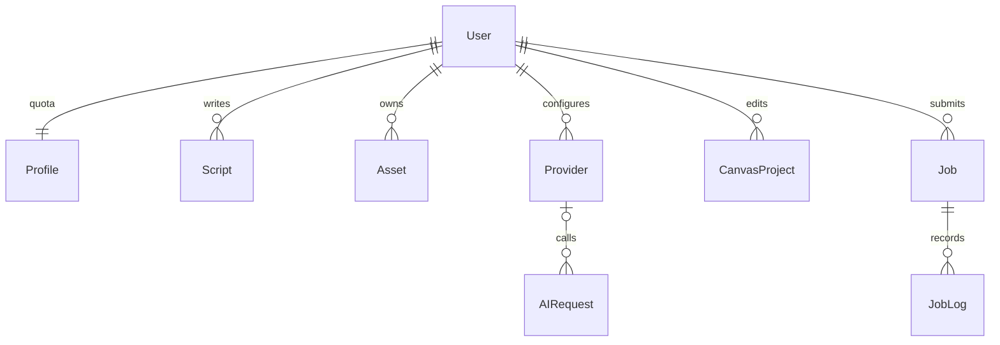

# 数据库与迁移

适用应用版本 `adbb539`。[模型定义](../backend/core/models.py)

| 模型 | 主要字段与职责 |
|---|---|
| `Profile` | 存储字节配额和剩余 AI 调用次数 |
| `Script` / `Asset` | 剧本保存标题、梗概、风格、分镜 JSON 与版本号。素材保存文件与缩略图的相对路径、哈希、大小、类型和标签 |
| `Provider` | LLM、TTS、视频、图片四类配置，保存 HTTPS 地址、模型、Fernet 密文、尾号和 `video_config` 映射 |
| `CanvasProject` | 用户、名称、`schema_version`、`revision` 与 `nodes` / `edges` / `viewport`。上限为 100 节点、200 条连线、512 KiB |
| `Job` / `JobLog` | 任务固定执行输入，保存结果、远端状态、阶段、进度、幂等键、执行租约和时间戳。任务日志记录阶段消息 |
| `AIRequest` | 调用涉及的供应商、服务、接口、HTTP 状态和完成时间，记录调用状态 |
| `PromptTemplate` / `WorkerHeartbeat` | 保存剧本风格提示词，记录 Worker 健康检查所需的心跳 |

素材按 `(user, sha256)` 去重。任务按 `(user, idempotency_key)` 去重，`status` 有索引。查任务、素材和剧本时还要验证所属用户，业务 ID 只用于定位。

`Job.snapshot` 存放提交时的画布、剧本版本、参考素材引用或供应商映射。`remote_state` 保存可用于恢复的远端任务 ID、提交结果与节点检查点。Key 仍存于供应商配置的加密字段，调用时按归属读取。

## 迁移记录

| 迁移 | 内容 |
|---|---|
| `0001` | 创建基础业务模型 |
| `0002` | 增加 `AIRequest` 审计 |
| `0003` | 增加供应商配置 JSON、视频服务与任务远端状态 |
| `0004` | 更新供应商服务类型，包含图片 |
| `0005`–`0006` | 同步管理后台中文模型和字段标签，包括素材类型 |

SQLite 使用 WAL、10 秒等待和 IMMEDIATE 事务。修改模型后先生成和审查迁移，在隔离环境运行测试，备份后用一次性部署步骤执行生产迁移。`manage.py showmigrations core` 用于核对已应用版本，`manage.py migrate --check` 用于检查有无未应用迁移。[备份与恢复](deployment-guide.md#备份恢复)
